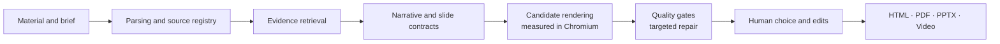

<div align="center">


# YingZhang · 映章

**Turn your source material into presentations that are sourced, editable and checked.**

A local-first AI workbench that reads PDF / Word / Excel / PowerPoint, plans the narrative, renders several candidates per slide,<br>
runs quality gates, and delivers HTML, PDF, natively editable PPTX and narrated video.

[](https://github.com/star031104/yingzhang-ai-ppt/releases)
[](https://github.com/star031104/yingzhang-ai-ppt/actions/workflows/ci.yml)
[](https://www.python.org/)
[](https://nodejs.org/)
[](https://react.dev/)
[](https://fastapi.tiangolo.com/)
[](docs/docker.md)
[](docs/integrations.md)

[Quick start](#quick-start) · [Capabilities](#capabilities) · [How it works](#how-it-works) · [Quality](#quality-and-evaluation) · [Agent integration](#agent-integration) · [Architecture (zh)](docs/architecture.md) · [中文](README.md)

</div>

> [!NOTE]
> The user interface is in Simplified Chinese. Documentation under `docs/` is in Chinese; code blocks are language-neutral.

---

## Why YingZhang

Most AI slide tools are good at "one prompt, ten slides". Real material raises harder questions: where did this number come from, why is this a chart, will editing one slide break another, can the exported PowerPoint still be edited?

YingZhang turns presentation production into a **traceable, checkable, resumable** pipeline. Models propose; deterministic code guards facts and layout.

| | Typical AI slide generator | YingZhang |
| --- | --- | --- |
| Facts | Free-form model output | Numbers, claims and tables bound to source locations; unsupported numbers are rejected |
| Layout | One template throughout | Chosen per slide role and data shape, with several candidates to pick from |
| Output | Images or loose text boxes | Charts, tables and diagrams as **native PowerPoint objects** |
| Long jobs | Restart from scratch | Bounded nodes with persisted snapshots: cancel, resume, redo one slide |
| Quality | Looks fine, ship it | Overflow, overlap, contrast, evidence coverage and licensing checks plus reproducible evaluation |
| Data | Uploaded to a platform | Projects, credentials and preferences stay on your machine |

## Capabilities

- **Material understanding** — PDF, DOCX, XLSX/CSV, PPTX, Markdown, HTML and images; keeps headings, table cells, units, captions and source locations; BM25 plus optional embeddings fused with RRF; optional local Tesseract OCR.
- **Planning and generation** — narrative planning from audience, objective, duration and tone; 15 presentation contracts; per-slide role, claim, evidence, text budget and object limits; model proposals validated against a number whitelist, duplicate titles and slide order; 9 visual skills with a `tokens.json` design grammar.
- **Editing and review** — side-by-side candidates with locked human choices, conversational object edits, **box-select region edits**, single-slide regeneration, versions, review notes, approvals and publish snapshots, plus a local assistant that learns from reference decks and confirmed edits.
- **Delivery** — HTML, PDF and **scene-driven native PPTX**; 8 native chart types (bar, column, line, area, doughnut, scatter, combo, waterfall); reference-deck layout library and corporate master filling; transitions and entrance animation; **narrated MP4 + SRT** from speaker notes.

## How it works



**Scene-driven PPTX export**: every slide is rendered and measured in Chromium. The real geometry of shapes, styled text runs, images, tables, charts and icons is compiled into native PowerPoint objects at 1280 px = 13.333 in. A slide whose scene is missing or fails validation falls back to the legacy compiler on its own, and the reason is written to the export report. The HTML preview and the PPTX therefore share one layout instead of two hand-written coordinate systems.

| Layer | Stack |
| --- | --- |
| Web workbench | React 19 · TypeScript · Vite · TanStack Query · Zustand |
| API and jobs | FastAPI · SQLAlchemy · Alembic · SQLite (WAL) |
| Rendering | Playwright · PptxGenJS · python-pptx · lxml |
| Parsing | PyMuPDF · python-docx · openpyxl · BeautifulSoup |
| Models | Any OpenAI-compatible endpoint (cloud or local), routed by role |

## Quick start

> You need at least one OpenAI-compatible model endpoint. Configure the base URL and API key on the in-app **模型配置** (Model settings) page; credentials go to the OS keyring, not `.env`.

**Windows** — clone the repository and double-click **`启动映章.exe`** (or `启动项目.cmd`). The first run installs uv, Python 3.12, Node.js LTS, locked dependencies and Playwright Chromium, builds the UI and opens `http://127.0.0.1:8000`.

**Docker**

```bash
docker compose up -d --build
```

The image includes Playwright Chromium, Noto CJK fonts and ffmpeg (LibreOffice and Tesseract via build args), keeps all state in the `/app/runtime` volume and binds to `127.0.0.1:8000`. See [docs/docker.md](docs/docker.md).

**Manual (macOS / Linux / development)**

```bash
git clone https://github.com/star031104/yingzhang-ai-ppt.git
cd yingzhang-ai-ppt
uv sync --locked --extra dev
npm ci
npx playwright install chromium
cp .env.example .env
npm run build
uv run --locked python -m uvicorn app.main:app --app-dir apps/api --host 127.0.0.1 --port 8000
```

App at `http://127.0.0.1:8000`, API docs at `/docs`, health check at `/api/v1/health`. For development, run the API with `--reload` and `npm run dev` (`http://127.0.0.1:5173`, proxied to the API).

## Quality and evaluation

| Check | Result |
| --- | --- |
| Python tests (API, workflows, parsing, MCP, video) | 300 passed |
| Presentation engine tests | 61 passed |
| Web component tests | 25 passed |
| Ruff · production build · benchmark gate | passing |
| PPTX cross-format fidelity (LibreOffice render vs HTML screenshot, mean of four benchmark families) | **98.7 – 99.5** (legacy exporter 81.6 – 86.9) |

- **PPTEval-style scores** (content / design / coherence, 1–5) and **quiz fidelity** (answering source questions from slide text only).
- **Render review** compares each exported slide, rendered through LibreOffice, with the selected HTML candidate.
- Run via `POST /api/v1/projects/{id}/evaluations` or `scripts/evaluate-deck.py`; LLM / VLM judges are optional.

```bash
uv run --locked --extra dev python -m pytest
npm run test:engine
npm run test:web
npm run build
uv run --locked --extra dev python scripts/verify-benchmarks.py
```

## Agent integration

The REST API is the single source of truth; agent integrations are thin wrappers and server-side gates still apply.

- **MCP server** — [`integrations/mcp/yingzhang_mcp.py`](integrations/mcp/yingzhang_mcp.py), a dependency-free stdio server with tools for projects, uploads, outline planning, generation, job status, slide edits, evaluation and export. Works with Claude Desktop, Claude Code, Codex and Cursor.
- **Agent skill** — [`integrations/skills/yingzhang-ppt/`](integrations/skills/yingzhang-ppt/SKILL.md) walks an agent through start, upload, outline and sample confirmation, generation, review and export without approving gates on the user's behalf.
- **Narrated video** — `POST /api/v1/projects/{id}/jobs/video` turns speaker notes into an MP4 with voice-over and SRT subtitles (requires ffmpeg).

```bash
claude mcp add yingzhang -e YINGZHANG_API_URL=http://127.0.0.1:8000 \
  -- /path/to/yingzhang-ai-ppt/.venv/bin/python /path/to/yingzhang-ai-ppt/integrations/mcp/yingzhang_mcp.py
```

## Configuration and deployment

Settings use the `YINGZHANG_` prefix (the legacy `SLIDEFORGE_` prefix still works; `YINGZHANG_` wins when both are set). See [`.env.example`](.env.example) and the [Chinese README](README.md#配置) for the full table.

- Run exactly **one** FastAPI process: the built-in job executor is single-instance and refuses to start with multiple workers.
- Migrations run on startup; in release pipelines run `python -m alembic -c apps/api/alembic.ini upgrade head` separately and set `YINGZHANG_MIGRATE_ON_STARTUP=false`.
- Back up the database and artifacts together with `scripts/backup_workspace.py`.
- The server listens on `127.0.0.1`; put an HTTPS reverse proxy with access control in front before exposing it.

## Data and privacy

`.env`, `runtime/`, databases, logs, personal experience, credentials and generated output are never committed. Every clone starts from an empty workspace. Credentials go to the OS keyring, falling back to an encrypted local file. Check your model provider's retention policy before uploading sensitive material.

## Limitations

- Fidelity is measured in LibreOffice; font substitution, line breaks and media in PowerPoint and WPS still need checking in the target environment.
- Scanned PDFs rely on local OCR; numbers and tables need human review.
- Complex formulas, unusual charts and third-party fonts may need manual fixes.
- Source binding reduces fabrication but does not replace fact-checking; image rights remain the user's responsibility.
- This is a 0.x release; APIs and data structures may still change.

## License

No open-source license is included yet. Unless the copyright holder grants permission, do not assume the code may be copied, modified or redistributed.
