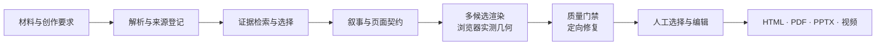

<div align="center">


# 映章 · YingZhang

**把你的材料，变成有出处、可编辑、经得起检查的演示文稿。**

本地优先的 AI 演示工作台：读懂 PDF / Word / Excel / PPT，规划叙事，逐页生成多个候选，<br>
自动做质量检查，最后交付 HTML、PDF、原生可编辑 PPTX 与讲解视频。

[](https://github.com/star031104/yingzhang-ai-ppt/releases)
[](https://github.com/star031104/yingzhang-ai-ppt/actions/workflows/ci.yml)
[](https://www.python.org/)
[](https://nodejs.org/)
[](https://react.dev/)
[](https://fastapi.tiangolo.com/)
[](docs/docker.md)
[](docs/integrations.md)

[快速开始](#快速开始) · [核心能力](#核心能力) · [工作原理](#工作原理) · [质量与评测](#质量与评测) · [Agent 集成](docs/integrations.md) · [工程架构](docs/architecture.md) · [开发报告](docs/development-report.md) · [English](README.en.md)

</div>

---

## 为什么是映章

多数 AI PPT 工具擅长“一句话出十页”。可一旦材料里有真实数字、口径限制和交付要求，问题就来了：这个数字从哪来？为什么这页用图表？改一页会不会动到别的页？导出的 PowerPoint 还能编辑吗？

映章把演示生产拆成一条**可追踪、可检查、可恢复**的流水线，模型负责提案，确定性程序守住事实与版式边界。

| | 常见 AI PPT 生成器 | 映章 |
| --- | --- | --- |
| 事实来源 | 模型自由发挥，数字难追溯 | 数字、结论、表格绑定到原文位置，未出现的数字会被拦截 |
| 版式决策 | 一套模板从头用到尾 | 按页面角色与数据形态选择版式，每页多个候选供人挑选 |
| 交付格式 | 常是图片或难编辑的文本框 | 图表、表格、流程图输出为 **PowerPoint 原生对象** |
| 长任务 | 中断后从头再来 | 有界节点 + 持久化快照，可取消、可恢复、单页重做 |
| 质量 | 看起来没问题即交付 | 溢出、重叠、对比度、证据覆盖、许可统一检查，附可复现评测 |
| 数据 | 上传到第三方平台 | 项目、凭据和个人偏好默认只留在本机 |

## 核心能力

<table>
<tr>
<td width="50%" valign="top">

**材料理解与证据**

- 解析 PDF、DOCX、XLSX/CSV、PPTX、Markdown、HTML、图片
- 保留章节层级、表格行列、单位、图注与来源定位
- BM25 + 可选向量检索（RRF 融合），长文不再只读开头
- 扫描件可接本机 Tesseract OCR，结果标记待核对

</td>
<td width="50%" valign="top">

**规划与生成**

- 按受众、目标、时长、语气规划叙事，15 类演示契约
- 每页声明角色、主张、证据、文字预算与对象上限
- 模型提议经校验：数字白名单、标题去重、页序与角色
- 9 套视觉技能，`tokens.json` 声明网格、字号阶梯与装饰语法

</td>
</tr>
<tr>
<td valign="top">

**编辑与协作**

- 多候选并排比较，人工选择会被锁定，不被后台覆盖
- 对象级对话修改、**框选局部修改**、单页重新生成
- 页面版本、审阅意见、审批与发布快照
- 本地个人助手：从参考稿和确认过的修改中学习偏好

</td>
<td valign="top">

**专业交付**

- HTML / PDF / **场景驱动的原生可编辑 PPTX**
- 8 类原生图表（柱、条、折线、面积、环形、散点、组合、瀑布）
- 参考 PPTX 版式库与企业母版填充，转场与入场动画
- 演讲备注合成 **讲解视频**（TTS 配音 + MP4 + SRT 字幕）

</td>
</tr>
</table>

## 工作原理



**场景驱动 PPTX 导出**：每个页面先在 Chromium 中渲染并测量，记录形状、文字段、图片、表格、图表与图标的真实几何，再按 1280 px = 13.333 in 编译成 PowerPoint 原生对象。场景缺失或校验失败的页面会单独回退到旧编译器，原因写入导出报告。HTML 预览与 PPTX 因此共享同一份版面，而不是两套各自手写的坐标。

| 层级 | 技术 |
| --- | --- |
| Web 工作台 | React 19 · TypeScript · Vite · TanStack Query · Zustand |
| API 与任务 | FastAPI · SQLAlchemy · Alembic · SQLite（WAL） |
| 演示引擎 | Playwright · PptxGenJS · python-pptx · lxml |
| 文档解析 | PyMuPDF · python-docx · openpyxl · BeautifulSoup |
| 模型接入 | 任意 OpenAI 兼容接口（云端或本机），按角色路由 |

## 快速开始

> 需要至少一个兼容 OpenAI API 的模型服务。模型地址与 API Key 在应用的“模型配置”页面填写，凭据保存在系统密钥环，不需要预先写进 `.env`。

### 方式一：Windows 一键启动

```powershell
git clone https://github.com/star031104/yingzhang-ai-ppt.git
cd yingzhang-ai-ppt
```

双击根目录的 **`启动映章.exe`**（或 `启动项目.cmd`）。首次运行会自动准备 uv、Python 3.12、Node.js LTS、锁定依赖与 Playwright Chromium，构建前端并打开 `http://127.0.0.1:8000`。需要联网，以及 Microsoft Store 中的“应用安装程序”（winget）。

<details>
<summary>启动器细节</summary>

- 端口被占用时：`powershell -NoProfile -ExecutionPolicy Bypass -File scripts/start-local.ps1 -Port 8001`
- 旧工作区若有孤立的候选稿或版本记录，启动器会先备份数据库到 `runtime/data/backups/` 再修复；其他数据库异常会停止启动并保留原数据。
- 关闭浏览器不会停止后台服务；日志位于 `runtime/launcher/`。
- `.exe` 由仓库内 C# 源码构建，可用 `./scripts/build-launcher.ps1` 重建（需要 .NET Framework 4.x 编译器）。

</details>

### 方式二：Docker

```bash
docker compose up -d --build
```

镜像内置 Playwright Chromium、Noto CJK 字体与 ffmpeg；LibreOffice 与 Tesseract 可通过构建参数开启（`YINGZHANG_INSTALL_LIBREOFFICE=true docker compose build`）。所有状态位于 `/app/runtime` 卷，默认只绑定 `127.0.0.1:8000`。详见 [Docker 部署说明](docs/docker.md)。

### 方式三：手动安装（macOS / Linux / 开发）

```bash
git clone https://github.com/star031104/yingzhang-ai-ppt.git
cd yingzhang-ai-ppt
uv sync --locked --extra dev
npm ci
npx playwright install chromium
cp .env.example .env            # Windows: Copy-Item .env.example .env
npm run build
uv run --locked python -m uvicorn app.main:app --app-dir apps/api --host 127.0.0.1 --port 8000
```

| 地址 | 用途 |
| --- | --- |
| `http://127.0.0.1:8000` | 应用 |
| `http://127.0.0.1:8000/docs` | API 文档 |
| `http://127.0.0.1:8000/api/v1/health` | 健康检查 |

开发模式：终端一运行 `python -m uvicorn app.main:app --app-dir apps/api --reload --port 8000`，终端二运行 `npm run dev`，访问 `http://127.0.0.1:5173`（`/api` 自动代理到 8000）。

## 使用流程

1. **新建演示**：填写主题、受众、沟通目标、时长与风格。
2. **上传材料**：核对读取结果，确认关键章节、数字、表格和限制条件。
3. **配置模型**：填写兼容 OpenAI 的服务地址、API Key 与模型，先做连接测试。
4. **确认大纲与样张**：审阅页面顺序与每页任务，确认代表页风格。
5. **生成与挑选**：全稿生成后在工作台选择候选、对象级或框选修改。
6. **质量检查**：处理内容遗漏、溢出、对比度、来源或许可问题。
7. **导出交付**：在 PowerPoint、WPS 或 LibreOffice 中复核后正式使用。

## 质量与评测

每次改动都由同一套自动化检查把关；评测指标对齐公开研究，且可离线复现。

| 检查项 | 当前结果 |
| --- | --- |
| Python 测试（API、工作流、解析、MCP、视频） | 300 项通过 |
| 演示引擎测试 | 61 项通过 |
| 前端组件测试 | 25 项通过 |
| Ruff · 前端生产构建 · 基准门禁 | 通过 |
| PPTX 跨格式保真度（LibreOffice 渲染 vs HTML 截图，四类基准平均） | **98.7 – 99.5**（旧导出器 81.6 – 86.9） |

- **PPTEval 三维评分**（内容 / 设计 / 连贯，1–5 分）与 **问答保真度**（只凭页面文字回答源材料问题）。
- **渲染复查**：导出的 PPTX 经 LibreOffice 渲染后与所选 HTML 候选逐页比对。
- 评测入口：`POST /api/v1/projects/{id}/evaluations` 或 `scripts/evaluate-deck.py`，可选接入 LLM / VLM 评委。
- 基准材料全部为合成或可再分发内容，见 [benchmarks/](benchmarks/README.md)。

```bash
uv run --locked --extra dev python -m pytest     # 后端
npm run test:engine                              # 演示引擎
npm run test:web                                 # 前端组件
npm run build                                    # 生产构建
uv run --locked --extra dev python scripts/verify-benchmarks.py
```

## Agent 集成

映章的 REST API 是唯一事实来源，Agent 侧只做薄封装，门禁、权限与导出检查仍由服务端执行。

- **MCP 服务器**：`integrations/mcp/yingzhang_mcp.py`，无 SDK 依赖的 stdio 服务器，提供建项目、上传材料、规划大纲、生成、查进度、改页面、评测和导出等工具，可接入 Claude Desktop、Claude Code、Codex 与 Cursor。
- **Agent Skill**：`integrations/skills/yingzhang-ppt/`，指导 Agent 按“启动 → 上传 → 确认大纲与样张 → 生成 → 复核 → 导出”的顺序工作，且不会替用户确认门禁。
- **讲解视频**：`POST /api/v1/projects/{id}/jobs/video`，把演讲备注合成为带配音与字幕的 MP4（需要本机 ffmpeg）。

```bash
claude mcp add yingzhang -e YINGZHANG_API_URL=http://127.0.0.1:8000 \
  -- /path/to/yingzhang-ai-ppt/.venv/bin/python /path/to/yingzhang-ai-ppt/integrations/mcp/yingzhang_mcp.py
```

其他客户端的配置示例见 [Agent 集成说明](docs/integrations.md)。

## 配置

环境变量统一使用 `YINGZHANG_` 前缀（旧的 `SLIDEFORGE_` 仍完全兼容，同时设置时以 `YINGZHANG_` 为准；进程环境变量优先于 `.env`）。完整模板见 [`.env.example`](.env.example)。

<details>
<summary>常用配置项</summary>

| 环境变量 | 默认值 | 说明 |
| --- | --- | --- |
| `YINGZHANG_DATABASE_URL` | `sqlite:///./runtime/data/yingzhang.db` | 本地数据库地址 |
| `YINGZHANG_MIGRATE_ON_STARTUP` | `true` | 启动时执行 Alembic 迁移；多副本部署应在发布阶段单独迁移并关闭 |
| `YINGZHANG_ARTIFACT_ROOT` | `./runtime/artifacts` | 上传材料与生成产物目录 |
| `YINGZHANG_CORS_ORIGINS` | 本地 5173 地址 | 开发环境允许的前端来源 |
| `YINGZHANG_PPTX_MODE` | `scene` | PPTX 导出方式，`legacy` 回到旧编译器 |
| `YINGZHANG_RENDER_CONCURRENCY` | `2` | 单个任务同时渲染的页面数，低内存设备建议 1 |
| `YINGZHANG_MAX_CONCURRENT_JOBS` | `2` | 同时执行的后台任务数（1–16） |
| `YINGZHANG_MAX_QUEUED_JOBS` | `6` | 等待任务上限，超过返回 503（0–64） |
| `YINGZHANG_OPTIONAL_IMAGE_WAIT_SECONDS` | `45` | 可选远程配图的单轮等待时间 |
| `YINGZHANG_LOCAL_ONLY_MODE` | `false` | 仅允许连接本机模型服务，禁用联网素材 |
| `YINGZHANG_VAULT_KEY` | 未设置 | 加密凭据回退文件的稳定密钥，容器与无头环境建议设置 |
| `YINGZHANG_SQLITE_BUSY_TIMEOUT_MS` | `15000` | SQLite 等待其他写入者的毫秒数 |
| `YINGZHANG_OFFICE_EXECUTABLE` | 自动发现 | LibreOffice 可执行文件 |
| `YINGZHANG_OCR_EXECUTABLE` | 自动发现 | Tesseract 可执行文件 |
| `YINGZHANG_OCR_LANGUAGES` | `chi_sim+eng` | OCR 语言包 |
| `YINGZHANG_OCR_MAX_PAGES` | `20` | 每份 PDF 最多识别的扫描页数 |
| `YINGZHANG_FFMPEG` | 自动发现 | 讲解视频使用的 ffmpeg |
| `YINGZHANG_TTS_VOICE` / `YINGZHANG_TTS_FORMAT` | `alloy` / `mp3` | 讲解视频配音音色与格式（需为 `tts` 角色配置模型） |
| `YINGZHANG_PRIVATE_ACCOUNTS_MODE` | `false` | 独立账号模式，本地单用户保持关闭 |

</details>

<details>
<summary>公网测试模式</summary>

| 环境变量 | 默认值 | 说明 |
| --- | --- | --- |
| `YINGZHANG_PUBLIC_TEST_MODE` | `false` | 共享公网测试模式，启动隧道前必须启用 |
| `YINGZHANG_PUBLIC_TEST_PASSWORD` | 未设置 | 测试者密码，至少 10 位 |
| `YINGZHANG_PUBLIC_ADMIN_PASSWORD` | 未设置 | 管理员密码，至少 12 位，且与测试者密码不同 |
| `YINGZHANG_PUBLIC_SESSION_SECRET` | 未设置 | 会话签名密钥，至少 32 位 |
| `YINGZHANG_PUBLIC_UPLOAD_LIMIT_MB` | `25` | 请求体总上限（缺少 `Content-Length` 时同样生效） |
| `YINGZHANG_TRUSTED_PROXY_IPS` | 未设置 | 仅用于限流识别的可信反向代理地址 / CIDR |

公网测试脚本会强制启用测试认证，并在建立隧道前确认未登录请求返回 401；凭据不满足要求时拒绝启动。

</details>

## 部署要点

- **单进程运行**：内置任务执行器只支持一个服务进程、一个实例；检测到多 worker 配置会拒绝启动。多实例需要共享队列与任务租约。
- **迁移**：启动时默认执行 `alembic upgrade head` 并核对表结构，不匹配会明确停止。多副本部署请在发布阶段单独迁移。迁移只向前，不要删除历史版本文件。
- **备份**：数据库与产物目录需一起备份。停止服务后执行 `python scripts/backup_workspace.py create runtime/backups/workspace.zip`，用 `verify` 校验、`restore --confirm` 恢复。
- **网络暴露**：默认只监听 `127.0.0.1`。对外提供访问前，需要自行配置 HTTPS 反向代理、访问控制与防火墙，不要直接暴露 Uvicorn 端口。
- **依赖锁定**：Python 使用 `uv.lock`，Node 使用 `package-lock.json`。PptxGenJS 4.0.1 依赖的 `image-size` 1.x 有高危漏洞，根目录暂时强制使用 2.0.4。

## 数据与隐私

- `.env`、`runtime/`、数据库、日志、个人经验、模型凭据与生成结果均不进入版本控制。
- 每个克隆实例都从空白工作区开始，不含维护者的账号、密钥、项目或偏好。
- 凭据优先存入系统密钥环，无法使用时才回退到本地加密文件。
- 上传敏感材料前，请确认所连接模型服务的数据处理与保留政策。

## 当前边界

- 跨格式保真度在 LibreOffice 上测得；PowerPoint 与 WPS 的字体替换、换行和媒体表现仍需在目标环境人工验收。
- 扫描 PDF 依赖本机 OCR，数字与表格需要人工核对。
- 复杂公式、特殊图表与第三方字体可能需要手动调整。
- 来源绑定能减少编造，但不能替代人工核实；网络图片的版权与肖像授权由使用者最终确认。
- 当前为 0.x 版本，接口与数据结构仍可能调整。

<details>
<summary>常见问题</summary>

**页面能打开，但生成任务失败**：先在“模型配置”中测试连接，确认 Base URL、API Key、模型名与额度，再查看 `runtime/launcher/` 日志。

**Chromium 或渲染不可用**：执行 `npx playwright install chromium`；Linux 按 Playwright 提示补齐系统依赖。

**端口 8000 被占用**：改用其他端口；开发模式下同步调整前端代理。

**如何清除本机数据**：优先使用应用内的清除与遗忘功能；需要完全空白的工作区时，退出服务并备份后运行 `scripts/reset-personal-workspace.py`。

</details>

## 项目结构

```text
yingzhang-ai-ppt/
├─ apps/
│  ├─ api/                     FastAPI：解析、检索、规划、任务、质量、评测、交付
│  └─ web/                     React 创作工作台
├─ packages/
│  ├─ presentation-engine/     HTML / PDF / PPTX 生成引擎（场景测量与原生导出）
│  ├─ scene-schema/            页面场景中间表示
│  └─ skill-schema/            视觉技能约束
├─ skills/visual/              9 套内置视觉技能
├─ integrations/               MCP 服务器与 Agent Skill
├─ benchmarks/                 可复现的渲染与评测基准
├─ test-materials/             可公开的验收材料
├─ tests/                      Python 自动化测试
├─ docs/                       架构、开发报告、Docker 与集成说明
├─ scripts/                    启动、验证、评测与维护脚本
└─ Dockerfile · docker-compose.yml · 启动映章.exe
```

## 参与开发

欢迎提交 Issue 与 Pull Request。提交前请运行与改动范围相关的测试，不要提交任何真实材料、账户数据、API Key、运行数据库或生成结果；架构层面的变更请同步更新 [工程架构](docs/architecture.md)。GitHub Actions 会在推送与 PR 时运行后端测试、前端测试、生产构建与 LibreOffice 往返检查。

## 许可证

当前仓库尚未附带开源许可证。除非版权所有者另行授权，请勿假定代码可以复制、修改或再分发。

<div align="center">
<sub>映章 · 让每一页都有出处</sub>
</div>
